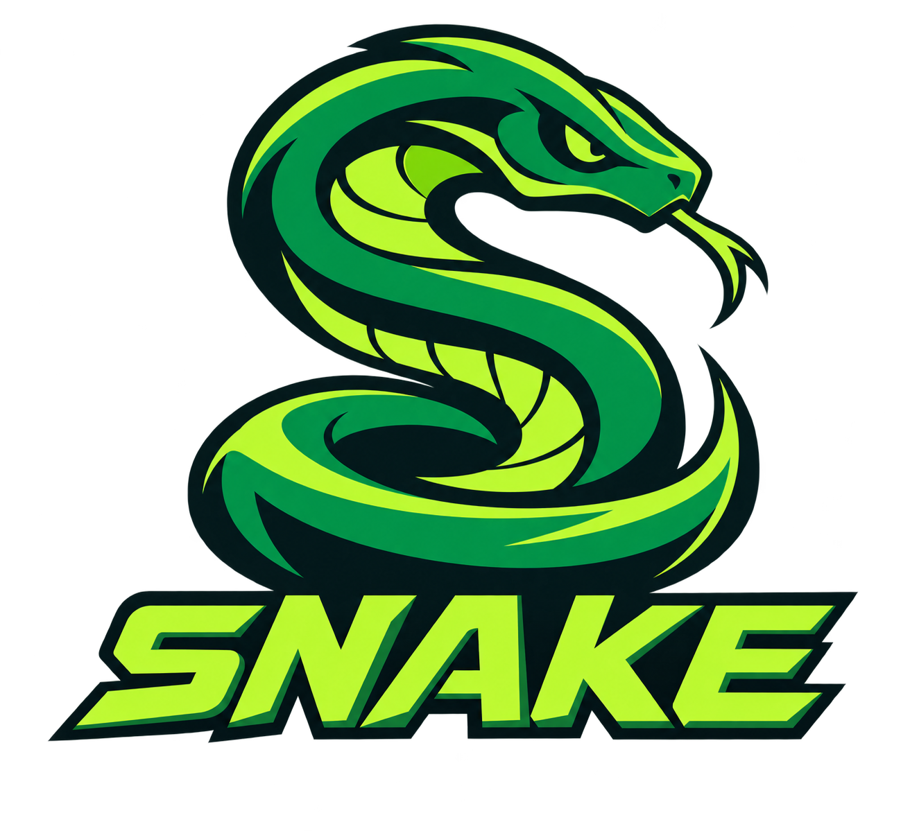

# SNAKE · Force Games

Criado e desenvolvido pela **[Force Games](https://www.forcegames.com.br)**.

Consulte clubes e jogadores de Street Fighter 6 pelo Buckler, com busca por parte do nome do clube e consulta individual do MR máximo histórico.

## Baixar para Windows

**[Baixar SNAKE.exe](https://github.com/xCoronelMakerx/SNAKE-Downloads/releases/latest/download/SNAKE.exe)**

[Ver versões disponíveis](https://github.com/xCoronelMakerx/SNAKE-Downloads/releases)

Requisitos: Windows 10/11 de 64 bits e Microsoft Edge WebView2 Runtime. Interface adaptada para monitores 1280 × 720. Não precisa instalar Python ou extensão no navegador.

## Como usar

1. Baixe **SNAKE.exe** na página da versão e abra o arquivo.
2. Entre na sua conta Capcom pelo navegador integrado e aguarde voltar ao Buckler. Conclua pessoalmente qualquer verificação de segurança.
3. Aguarde **Conectado ao Buckler** ou clique em **Verificar login**.
4. Digite parte do nome do clube e clique em **Buscar clubes** (ou pressione Enter). Online são exigidos pelo menos **4 caracteres**: `ubbc` encontra UbbClan. Nos clubes já conhecidos pela base local, trechos menores como `ubb` também funcionam.
5. Selecione o clube e clique em **Listar jogadores**. Na primeira consulta a lista é salva; nas próximas, é aberta da base local. Use **Atualizar lista** para consultar novamente os membros online.
6. Clique em **MR máx.** ao lado do jogador desejado para consultar o recorde entre os personagens e fases disponibilizados pelo Buckler.
7. Exporte os resultados em **CSV** ou **Excel**, se desejar.

Clique numa linha de jogador para copiar o **User Code**. O botão **MR máx.** mantém a consulta individual. A base local guarda nomes e códigos por clube, com data de atualização, e não armazena MR. Ao reabrir a lista, o MR volta a **Não consultado**.

A sessão de login e a preferência de tema claro/escuro ficam salvas no computador. A Capcom pode solicitar novo login quando a sessão expirar. Use **Mostrar navegador** para abrir novamente a aba do site.

O total de horas Steam/console não está disponível na fonte consultada e permanece indisponível. A listagem não consulta o MR de todos os jogadores automaticamente.

## Sobre este repositório

Este é o canal público de **distribuição** do SNAKE. Contém instruções, marcas, verificações de integridade e executáveis nas releases. O código-fonte é mantido em repositório privado.

Os arquivos **Source code (zip/tar.gz)** gerados automaticamente pelo GitHub contêm somente os arquivos deste repositório de distribuição. Para usar o programa, baixe **SNAKE.exe**.

Copyright © 2026 **Force Games**. Todos os direitos reservados aos materiais próprios. A publicação do executável não concede uma licença de código aberto. Marcas, serviços e dependências de terceiros seguem seus próprios direitos e licenças. Veja [NOTICE](NOTICE).

